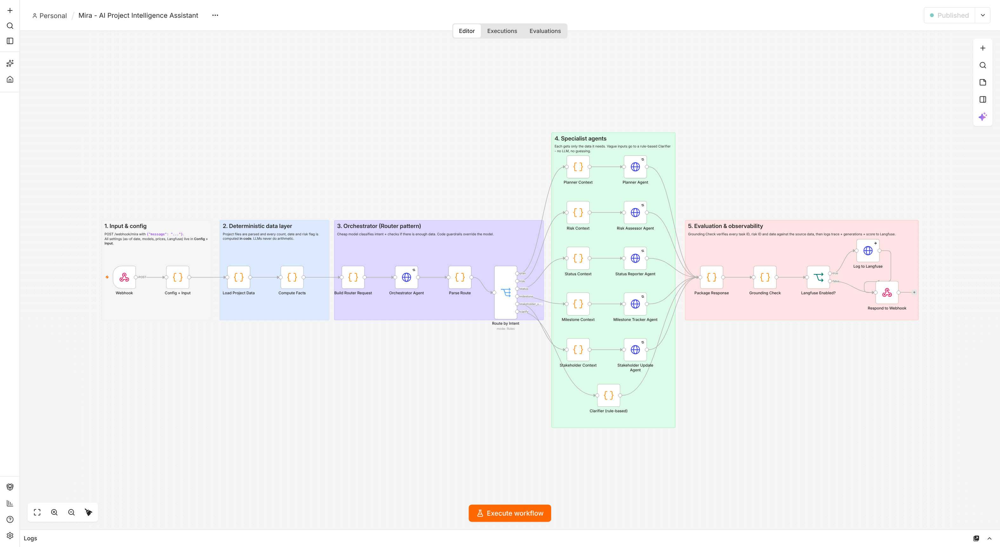
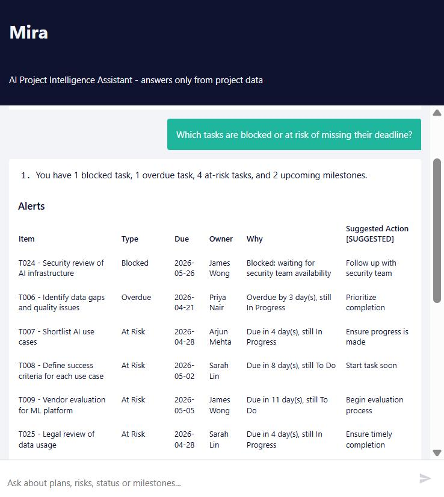
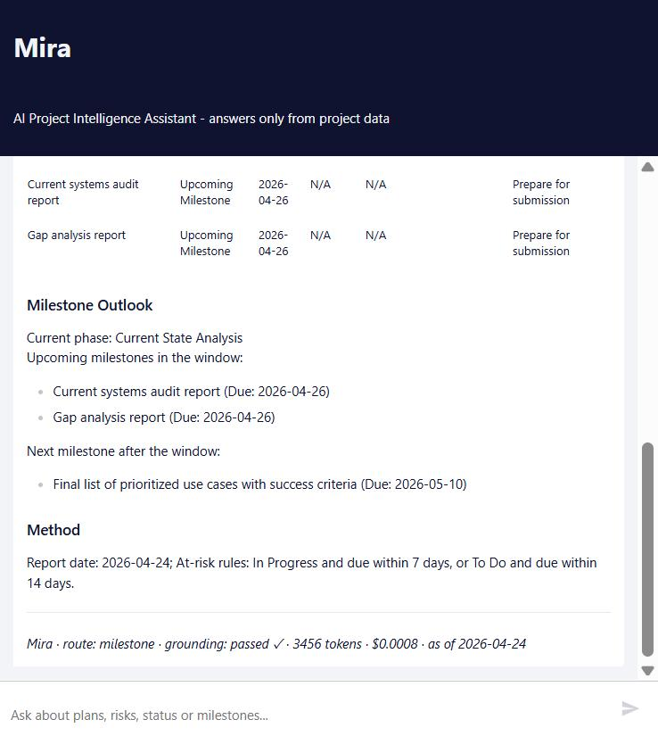
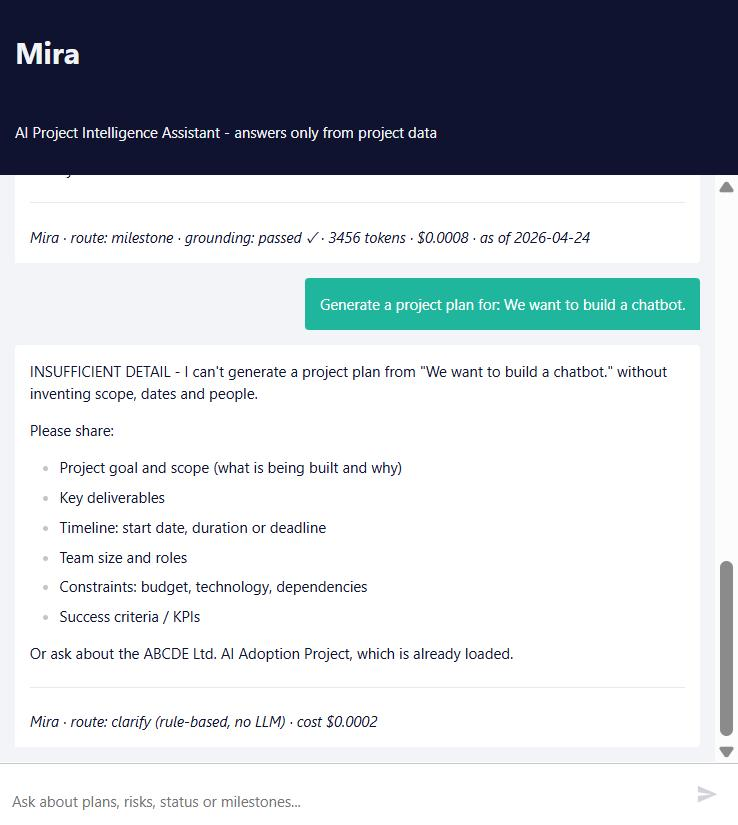
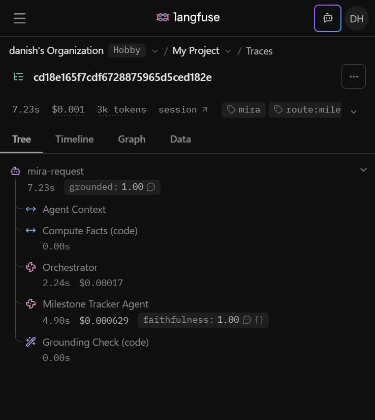
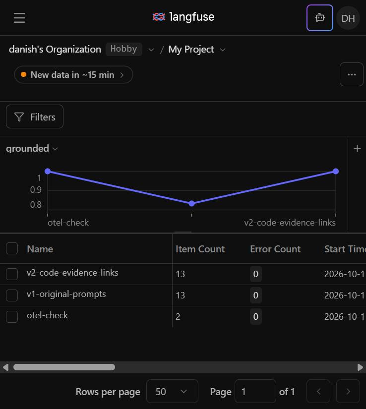
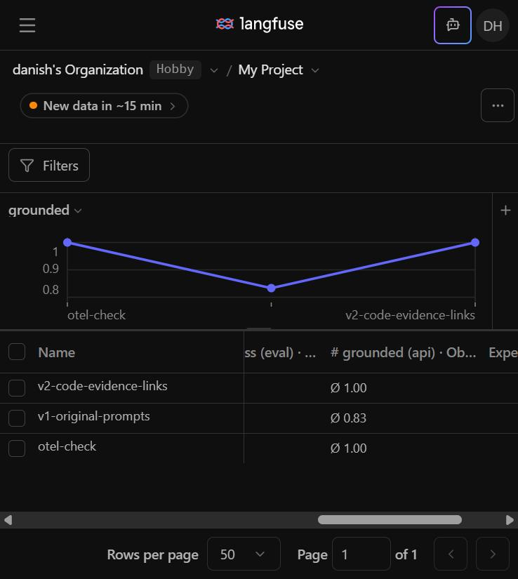
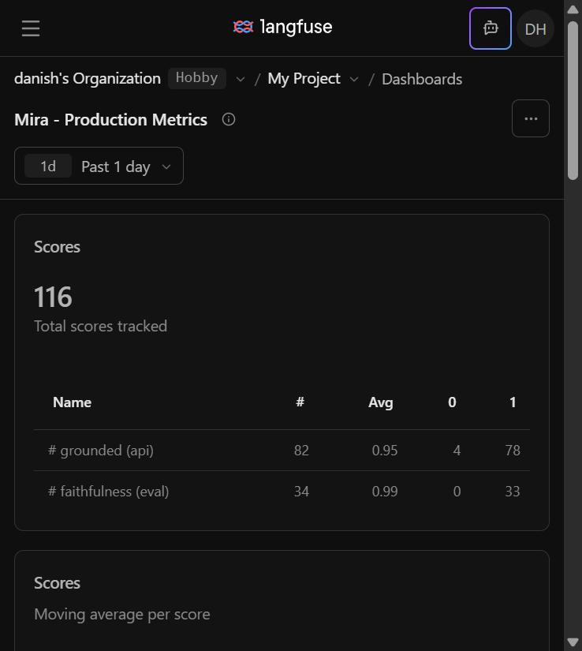

# Mira — AI-Powered Project Intelligence Assistant

Capstone project for *Applied Agentic AI for PMs/TPMs*. Mira is a multi-agent n8n workflow that generates **project plans, risk assessments, weekly status reports, milestone alerts and stakeholder updates**, grounded in a project's own files (ABCDE Ltd. AI Adoption Project). It is built so the LLM never has to invent anything.

> **Evaluators:** open [`START_HERE.html`](START_HERE.html) for a guide to every file, with clickable local and GitHub links.


## Design in one paragraph
**Router pattern.** A cheap Orchestrator (gpt-4o-mini, JSON mode) classifies each request; code guardrails then route it to one of five specialist agents, or to a rule-based Clarifier when the input is too vague. **All counting, filtering and date maths happen in a Code node** (*Compute Facts*), so agents only format and explain numbers they were given. A **Grounding Check** evaluator verifies every task ID, risk ID, date, count, % complete, health rating and task status in each answer against the source data, and the whole run is traced in **Langfuse** (one generation per agent with tokens and cost, plus a `grounded` score).

| Capability | Agent | Type |
|---|---|---|
| Project Plan Generation | Planner Agent | Core |
| Risk Assessment | Risk Assessor Agent | Core |
| Weekly Status Report | Status Reporter Agent | Core |
| Milestone Alert System | Milestone Tracker Agent | Extended |
| Stakeholder Update Generator | Stakeholder Update Agent | Extended |
| Vague / no-data handling | Clarifier (rule-based) | Guardrail |

## Repository
```
workflow/mira_workflow.json      ← import this into n8n (no credentials inside)
workflow/build_workflow.py       ← rebuilds the JSON from prompts/ + data/ + src/
workflow/src/*.js                ← source of every Code node (readable, reviewable)
prompts/*.md                     ← system prompt of every LLM agent
data/                            ← project description, timeline, risks, task board, eval inputs
tests/run_tests.py               ← runs the 12 baseline inputs, auto-checks, writes results
tests/test_grounding_check.mjs   ← offline test of the Grounding Check: injected wrong counts/statuses must be flagged
tests/mock_openai_server.py      ← offline mock of OpenAI + Langfuse for plumbing tests
tests/results/                   ← baseline_results.md + results.json (after you run the tests)
docs/Q1_ideation.md  docs/Q2_architecture_writeup.md  docs/Q3_program_charter.md  docs/Q4_reflection.md
diagram/mira_architecture.png    screenshots/  (canvas, chat, Langfuse)
```

## Setup (about 10 minutes)
Tested on n8n **2.42.6**. Uses only core nodes (Webhook, Code, HTTP Request, Switch, If, Respond to Webhook), so it also works on n8n 1.x and n8n Cloud.

1. **Import** — n8n → *Workflows* → *Import from file* → `workflow/mira_workflow.json`.
2. **OpenAI credential** — open **Orchestrator Agent** → *Credential for OpenAI* → *Create new* → paste your API key. Then select the same credential on the 5 other agent nodes (Planner, Risk Assessor, Status Reporter, Milestone Tracker, Stakeholder Update).
3. **Publish / activate** the workflow. Copy the **production** webhook URL from the *Webhook* node (`…/webhook/mira`).
4. **Chat window:** open the **Chat with Mira** node and copy its **Chat URL** (`https://<your-n8n>/webhook/<id>/chat`). It's a hosted chat page; each reply ends with an audit line (route, grounding result, tokens, cost). You can also use the **Open chat** button in the editor.
5. **Try it via API:**
   ```bash
   curl -X POST https://<your-n8n>/webhook/mira -H "Content-Type: application/json" \
        -d '{"message": "Which tasks are blocked or at risk of missing their deadline?"}'
   ```
   The response is JSON: `answer`, `route`, `grounding` (passed + flags), per-agent `tokens / cost / latency`, `trace_id`.
6. **Langfuse (observability)**
   - Create a project at [cloud.langfuse.com](https://cloud.langfuse.com) → *Settings* → *API keys*.
   - In n8n, create a credential of type *Basic Auth*: **User = public key** (`pk-lf-…`), **Password = secret key** (`sk-lf-…`).
   - In **Config + Input**, set `langfuse_enabled: true` (and `langfuse_host` to `https://us.cloud.langfuse.com` if your project is in the US region).
   - Mira sends traces as **OpenTelemetry** spans to `/api/public/otel/v1/traces` (with header `x-langfuse-ingestion-version: 4`, so they appear immediately) and the `grounded` score to `/api/public/scores`. The legacy `/api/public/ingestion` API is not used; Langfuse Cloud retires it on 16 Nov 2026.
   - Attach the same Langfuse credential to **Log to Langfuse** and **Log Score to Langfuse**.
   - Each request now shows as a trace `mira-request` with spans *Compute Facts (code)*, *Orchestrator*, the specialist agent, *Grounding Check (code)* and a `grounded` score.
7. **Run the baseline test dataset** (Python 3, standard library only):
   ```bash
   python3 tests/run_tests.py --url https://<your-n8n>/webhook/mira
   # or score saved responses: python3 tests/run_tests.py --from-json tests/results/run2_results.json
   ```
   This writes `tests/results/baseline_results.md`: the documentation table per test (input, output, expected keywords present or missing, hallucination check, pass/fail) plus a summary with tokens, cost and latency.

## Evaluation in Langfuse
- **Dataset:** import `workflow/experiments/langfuse_dataset_setup.json` into n8n, attach the Langfuse credential to its two HTTP nodes, and click *Execute workflow* once. It creates the dataset `mira-baseline` (items `mira-T1` … `mira-T12`).
- **Experiments:** send a test request with `"experiment": {"run_name": "<name>", "dataset_item_id": "mira-T8", "dataset_id": "<Langfuse dataset id>", "expected_output": "..."}`. Mira adds Langfuse experiment attributes to the OpenTelemetry spans, so the run appears in Langfuse → Experiments in real time. The v1 comparison workflow is `workflow/experiments/mira_workflow_v1.json` (webhook `/webhook/mira-v1`; rebuild with `python3 workflow/build_workflow.py --v1`).
- **LLM judge:** in Langfuse, Evaluators → `faithfulness` (gpt-4.1-mini, score 0–1), with a rule on observations `type:GENERATION -name:Orchestrator`. It needs an OpenAI LLM connection in Langfuse settings.
- **Dashboard:** "Mira - Production Metrics" shows scores, score trend, latency percentiles per agent, cost per agent and request mix.

## Screenshots
| | |
|---|---|
| **Workflow canvas** (n8n) |  |
| **Mira in action: milestone alerts** (chat window) |  |
| **Mira in action: audit footer** (route, grounding, tokens, cost) |  |
| **Mira in action: vague request goes to the Clarifier** (no LLM, no guessing) |  |
| **Langfuse trace tree**: Orchestrator → specialist → Grounding Check, `grounded` and `faithfulness` scores |  |
| **Langfuse experiments**: v1 vs v2 runs on the 12-item dataset |  |
| **Langfuse experiment scores**: grounded v1 Ø0.83 → v2 Ø1.00 |  |
| **Langfuse dashboard**: "Mira - Production Metrics" |  |

## Configuration (node *Config + Input*)
| Setting | Default | Why |
|---|---|---|
| `as_of_date` | `2026-04-24` | "Today" for the project. The sample board runs Apr–Aug 2026 with Sprint 3 active. It can also be passed per request: `{"message": "...", "as_of_date": "2026-05-15"}` |
| `project_start` | `2026-03-30` | Monday of timeline week 1, consistent with the Sprint 1 due dates |
| `at_risk_days_in_progress` / `at_risk_days_todo` | 7 / 14 | At-risk rules for the Milestone Tracker |
| `milestone_window_days` | 14 | "Upcoming milestones" window |
| `router_model` / `specialist_model` | `gpt-4o-mini` | Switch the specialists to `gpt-4.1` / `gpt-4o` if needed; cost is tracked automatically |

## Offline plumbing test (no API key)
```bash
python3 tests/mock_openai_server.py     # mock OpenAI + Langfuse on :9911
python3 workflow/build_workflow.py --local-test   # build that points at the mock
```
Add `[inject-hallucination]` to a request and the mock cites a fake task, a fake risk, an unknown date and an out-of-sprint task. The Grounding Check flags all four.

## Grounding Check regression test (offline, Node 18+)
```bash
node tests/test_grounding_check.mjs
```
It runs the Code-node source from `workflow/mira_workflow.json` without n8n or an API key. It injects 7 hallucinations that only look plausible (wrong task counts in prose and in a table, wrong % complete, wrong health rating, a Blocked task called Done, an overdue task called on track, a To Do task called overdue): each must be flagged. It then replays the real project-data answers from the final live run: none may be newly flagged.

## Editing
Change a prompt in `prompts/` or code in `workflow/src/`, run `python3 workflow/build_workflow.py`, and re-import. Re-run `tests/run_tests.py` and `node tests/test_grounding_check.mjs` after every change (they are the regression suite).

## Submission checklist
- [x] Workflow JSON + README (this repo)
- [x] Architecture diagram — `diagram/mira_architecture.png`
- [x] Write-up with tool rationale, pattern, agents, cost analysis and metrics — `docs/Q2_architecture_writeup.md`
- [x] Q1 Ideation, Q3 Program Charter, Q4 Reflection — `docs/`
- [x] Baseline results (all 12), two live runs: `tests/results/run1_baseline_results.md` (11/12) → `tests/results/baseline_results.md` (12/12 after fixes)
- [x] Screenshots: workflow canvas, Mira in action (chat window), Langfuse traces, experiments and dashboard → `screenshots/`
- [ ] Slide deck
- [ ] Public GitHub link submitted

**Author:** Danish
