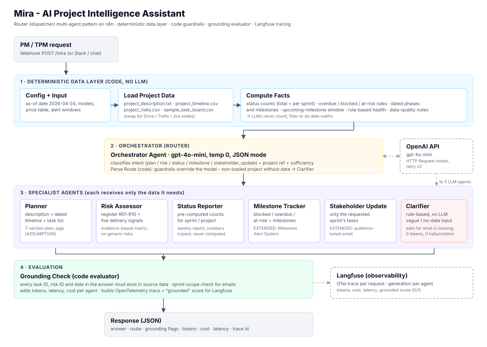

# Q2 — Mira: Architecture, Implementation & Evaluation Write-up

**Author:** Danish · **Capstone:** Applied Agentic AI for PMs/TPMs — Mira (Nexora)

## 1. Problem summary
Nexora's PMs/TPMs run 3–5 projects at once and spend 3–4 hours writing each project plan, 1–2 hours a week compiling status reports from task boards, and produce risk assessments that vary from person to person. Mira is a multi-agent assistant that generates project plans, risk assessments, weekly status reports, milestone alerts and stakeholder updates from a project's own files. The biggest risk is fabrication — invented milestones, task statuses or generic risks that a PM forwards to leadership — so Mira is designed so the LLM never has to compute or guess anything.

## 2. Architecture

**Flow:** Webhook → Config + Input → Load Project Data → **Compute Facts (code)** → Orchestrator Agent (LLM) → Parse Route (code guardrails) → Switch → one of 5 specialist agents or the rule-based Clarifier → Package Response → **Grounding Check (code evaluator)** → Langfuse → Response.

## 3. Tool selection

| Category | Choice | Why |
|---|---|---|
| Workflow platform | **n8n** | Visual multi-agent canvas, native Webhook/Switch/Code/HTTP nodes, and I already run an n8n + Slack bot, so Mira can be exposed in Slack with no new platform. |
| LLM | **gpt-4o-mini** for all agents (configurable per agent in one node) | Routing and formatting pre-computed facts do not need a frontier model. ~$0.001 per request. Planner/Risk can be switched to gpt-4.1 / gpt-4o in Config if quality demands it. |
| LLM integration | **HTTP Request → OpenAI Chat Completions** (not the AI Agent node) | Full control of temperature and JSON mode, and the raw `usage` field gives exact tokens per agent for cost tracking and tracing. |
| Data | Project CSV/TXT files parsed in a Code node | Works on n8n Cloud and self-hosted; swap for Google Drive / Trello / Jira nodes later without touching the agents. |
| Observability | **Langfuse** (OpenTelemetry endpoint + Scores API) | One trace per request with typed observations (agent → span → generation → evaluator), tokens, cost and latency per agent, plus a `grounded` score. I first used the v3 ingestion API, but its response warned it is retired on 16 Nov 2026 and delays data, so I migrated to OTLP before submission. Free Hobby tier (50k units/month) covers evaluation and a 10-PM pilot. |

## 4. Orchestration pattern — Router / Dispatcher
Mira's inputs are **different request types that need different data and different output formats** (plan, risk, status, milestone tracking, stakeholder email). A sequential pipeline would run every agent on every request, adding cost and giving agents irrelevant data to hallucinate from. A hierarchical pattern is unnecessary because no test request needs several agents to collaborate. So: one cheap Orchestrator classifies the request, and exactly one specialist answers it.

Two design decisions make the router reliable:
1. **Code overrides the model.** The Orchestrator returns JSON (`intent`, `project_ref`, `sprint`, `sufficient`, `missing_info`). The *Parse Route* code node then applies hard rules: a status/milestone/stakeholder request for a project with no loaded data, or a plan/risk request that is not sufficient, always goes to the Clarifier — whatever the model said.
2. **Vague inputs never reach an LLM.** The Clarifier is rule-based: it lists exactly what is missing for that request type. Zero tokens and zero chance of a "helpful" invented plan.

## 5. Agents

| Agent | Input (only what it needs) | Output | Key prompt rules |
|---|---|---|---|
| **Orchestrator** (LLM, temp 0, JSON) | User request + list of loaded data | Intent, project ref, sprint, sufficiency, missing info | Strict sufficiency rules; "at risk of missing deadline" = milestone, not risk |
| **Planner** (LLM) | Description, timeline with code-computed dates, task list | 7-section plan: summary, goals, phase table, milestones, team, dependencies, open questions | No invented goals/dates/people; inferences tagged `[ASSUMPTION]`; flag board/timeline mismatches |
| **Risk Assessor** (LLM) | Risk register R01–R10 + delivery signals (blocked, overdue, at-risk, security/compliance/vendor tasks) | Risk matrix with evidence column, or ranked answer to a question | Only R01–R10; no generic risks; mitigation copied from register; "No current signal" when none |
| **Status Reporter** (LLM) | Pre-computed counts and task lists for the scope | Weekly report or a direct count answer | Every number copied from FACTS; no percentages not in FACTS |
| **Milestone Tracker** (LLM) — *extended* | Dated phases, milestones in the 14-day window, blocked/overdue/at-risk tasks with reasons | Direct answer + alerts table + outlook | Only timeline milestones; "Why" must quote the computed reason |
| **Stakeholder Update** (LLM) — *extended* | **Only** the requested sprint's tasks + audience | Professional email | Out-of-scope sprints are never in its context, so they cannot leak |
| **Clarifier** (code) | Router output | What's missing + what Mira can do | Deterministic |
| **Compute Facts** (code) | All project files | Counts, dates, flags, health | All arithmetic and filtering lives here |
| **Grounding Check** (code) | Answer + source facts | Pass/flags, cost, Langfuse batch | Every task ID, risk ID and date cited must exist; sprint-scope check |

**Reference date.** The sample board runs April–August 2026 with Sprint 3 active, so Mira reports *as of 24 Apr 2026* (end of timeline week 4; week 1 starts 30 Mar 2026, consistent with the Sprint 1 due dates). Without a fixed date, "next 2 weeks" and "at risk" are undefined and the LLM would guess. The date is one setting in *Config + Input*, or can be passed per request.

**At-risk rules (documented, deterministic):** Blocked = status Blocked · Overdue = not Done and past due · At risk = In Progress due within 7 days, or To Do due within 14 days. **Health:** RED if ≥3 blocked+overdue, AMBER if ≥1, else GREEN.

## 6. Cost analysis
**Measured on the live run** (n8n Cloud, gpt-4o-mini, 12 baseline inputs, Run 2). Mira returns per-agent tokens and cost in every response. Prices (OpenAI list, per 1M tokens): gpt-4o-mini $0.15 in / $0.60 out.

| Test | Route | Tokens in / out | Cost | Latency |
|---|---|---|---|---|
| T1 plan | Planner | 3,883 / 1,036 | $0.00120 | 10.9 s |
| T3 risk assessment | Risk Assessor | 3,532 / 916 | $0.00108 | 10.6 s |
| T7 top-3 risks | Risk Assessor | 3,530 / 294 | $0.00071 | 3.3 s |
| T5 sprint status | Status Reporter | 2,545 / 447 | $0.00065 | 4.4 s |
| T10 status counts | Status Reporter | 4,067 / 158 | $0.00071 | 2.3 s |
| T8 / T11 milestones | Milestone Tracker | 2,842 / 632 | $0.00080 | 6.3–7.9 s |
| T12 stakeholder email | Stakeholder Update | 1,452 / 224 | $0.00035 | 3.3 s |
| T2/T4/T6/T9 vague | Clarifier (router only) | ~772 / ~95 | $0.00017 | 1.3–1.9 s |
| **All 12** | | | **$0.0070 total · $0.00058 avg** | p50 3.3 s · max 10.9 s |

The estimates made before the run, using exact prompt tokens and estimated outputs, were within about 10% of these measured values.

| Request type | Router in/out | Specialist in / out (est.) | Cost per request |
|---|---|---|---|
| Project plan | 779 / 70 | 3,105 / 1,100 | $0.0013 |
| Risk assessment | 779 / 70 | 3,262 / 1,200 | $0.0014 |
| Sprint status report | 775 / 70 | 1,772 / 700 | $0.0008 |
| Project status counts | 780 / 70 | 3,289 / 300 | $0.0008 |
| Milestone / blocked tasks | 776 / 70 | 1,948 / 500 | $0.0008 |
| Stakeholder email | 771 / 70 | 682 / 300 | $0.0004 |
| Vague input → Clarifier | 778 / 70 | 0 / 0 (code) | $0.0002 |

| Cost item | Estimate |
|---|---|
| Average cost per request (measured: $0.00058 across the 12 tests; $0.00079 for LLM-answered requests) | ~$0.0008 |
| Requests per PM per day | 15 (e.g. 3 status, 4 milestone checks, 2 stakeholder updates, 2 risk questions, 1 plan/week, 3 ad-hoc incl. vague) |
| **Cost per PM per day** | **~$0.012** → **~$0.26 per month** (22 working days) |
| Same mix with gpt-4o for all specialist agents | ~$0.01 per request → ~$3.30 per PM per month |
| Data/API calls | CSV parsing in n8n — no API cost; Trello/Jira APIs free at this volume |
| Langfuse | Free Hobby tier (50k units/month): ~6 events per request × 15 × 22 ≈ 2k per PM per month; a 10-PM pilot ≈ 20k |
| **Pilot total (10 PMs)** | **≈ $3/month LLM** + n8n hosting |

**Per plan:** ~$0.0013 versus 3–4 hours of PM time. The cost driver is input context, not output — which is why each specialist gets only its slice of data.

## 7. Evaluation strategy — production metrics

| # | Metric | Definition | Target | How measured |
|---|---|---|---|---|
| 1 | **Groundedness rate** | % of responses where every cited task ID, risk ID and date exists in source data | ≥ 98% | Automatic: Grounding Check `grounded` score in Langfuse |
| 2 | **Status accuracy** | % of status reports whose counts match the task board | 100% | Counts come from code; spot-check weekly against board export |
| 3 | **Correct refusal rate** | % of vague / no-data requests routed to the Clarifier (no plan, risk or status invented) | 100% on the vague test set | Langfuse filter `route:clarify` vs labelled vague inputs |
| 4 | **Plan groundedness** | % of milestones in generated plans traceable to the timeline | 100% | Test-runner check + monthly sample review |
| 5 | **Time saved / adoption** | Minutes saved per status report and plan; weekly active PMs | ≥ 60 min/PM/week; 8 of 10 pilot PMs weekly | Before/after survey + n8n execution counts |
| 6 | **Cost & latency** | USD and p95 latency per request | < $0.002, p95 < 15 s | Langfuse dashboards |

## 8. Testing observations
**Found while building (before the LLM run):**
- **The problem statement's sample-data note is wrong.** It says the board has "3 Done … the rest To Do". The CSV actually has **5 Done (T001–T005), 3 In Progress (T006, T007, T025), 1 Blocked (T024), 16 To Do**. Because counts come from code, Mira reports the real numbers; an LLM "anchored" on the brief would fail T10.
- **The board and the timeline don't fully line up.** The last task is due 4 Aug 2026 but timeline week 24 ends 13 Sep 2026, and several deployment tasks fall before their phase window. Mira surfaces this as a data note instead of silently "fixing" dates.
- **Router ambiguity → fixed.** "Which tasks are … *at risk* of missing their deadline" (T8) collides with the *risk* intent. Added an explicit disambiguation rule to the Orchestrator prompt (task delivery = milestone; risk register = risk), and the mock-router regression run now routes T8 correctly.
- **T006 is the hidden test.** Besides the deliberately blocked T024, T006 (Sprint 2, due 21 Apr) is still In Progress as of 24 Apr, so it is overdue and is also the correct "carry-over" in the Sprint 2 stakeholder email.
- **Grounding Check verified** with an injected hallucination (fake task T099, risk R13, an unknown date and an out-of-sprint task): all four were flagged.

**Live baseline runs** (n8n Cloud, gpt-4o-mini). Results are in `tests/results/` (`run1_baseline_results.md` and `baseline_results.md`).

| | Run 1 (v1) | Run 2 (v2, after fixes) |
|---|---|---|
| Automatic keyword checks | 11/12 (T8 failed) | **12/12** |
| Routed correctly | 12/12 | 12/12 |
| Vague inputs refused (T2, T4, T6, T9) | 4/4 | 4/4 |
| Grounding check passed | 12/12 | 12/12 |
| Manual review issues | 2 (T7, T8) | 0 |
| Total cost of 12 tests | $0.0074 | $0.0070 |

**What went wrong in Run 1, and the fix (the evaluate → fix → re-evaluate loop):**
1. **T8 omitted a task.** The Milestone Tracker said "4 tasks at risk" but listed only 3 (it dropped T009). It also named tasks without IDs, so "T024" never appeared literally. **Fix:** code now passes `alert_counts`; the prompt requires the task ID in every row and a row count equal to `total_task_alerts`. **After:** all 6 alerts listed with IDs (T024, T006, T007, T008, T009, T025).
2. **T7 linked evidence to the wrong risk.** The blocked *security* review (T024) was cited as evidence for R02 *Integration*, and R04 was justified with "ongoing tasks related to stakeholder engagement", which cites no task. The top-3 also disagreed with T3. **Fix:** risk-to-task evidence links and the ranking are now computed in code (security → R09, compliance/legal → R05, data → R01, vendor/platform → R10, and so on; score = Blocked 30 / Overdue 20 / At risk 10 + priority). The agent may only quote those links. **After:** R09 (T024 blocked) → R01 (T006 overdue) → R05 (T025 at risk), with consistent evidence, and the answer is 70% shorter ($0.0012 → $0.0007).
3. **The evaluator had a blind spot.** The Grounding Check passed both failures, because it detected *invented* IDs but not *omitted* or *mislinked* ones. **Fix:** added completeness checks (every alert task in milestone answers, every in-scope task in sprint reports and emails). Mislinked evidence is now prevented by construction rather than detected afterwards.
